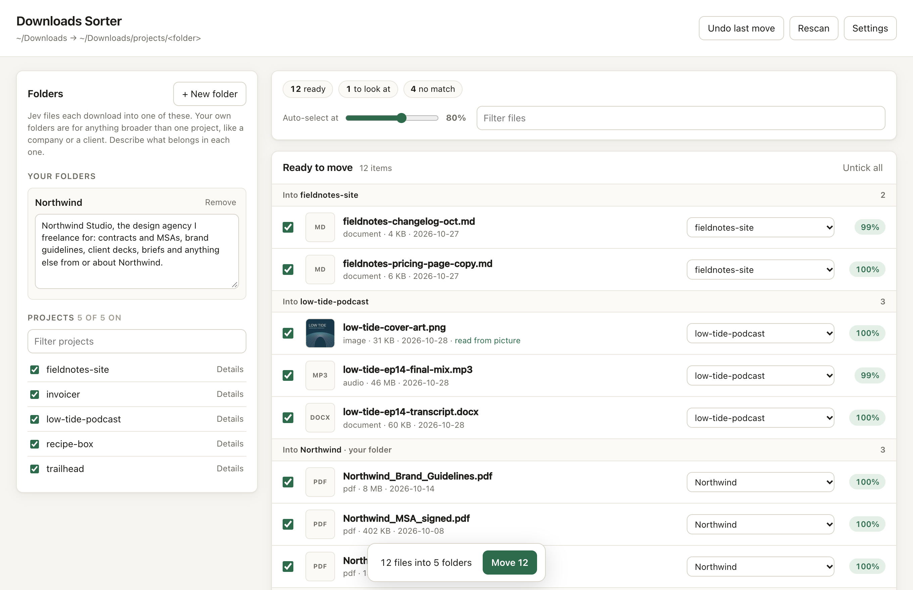
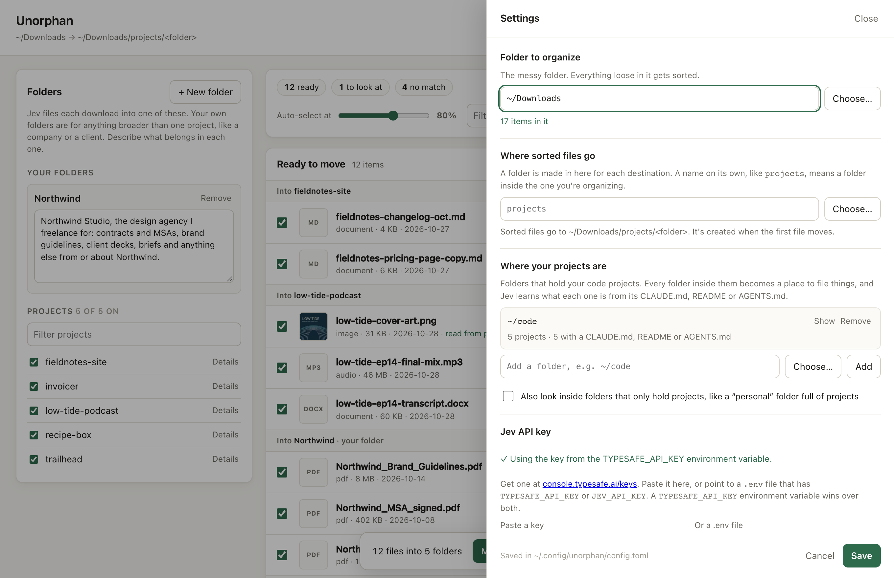

# Unorphan

Finds a home for the orphaned files in your Downloads folder.



If you work on a few projects at once, your Downloads folder is where their files pile up: the
podcast episode you exported, a client's brand guidelines, a CSV from some dashboard, a screenshot
called `Screenshot 2026-10-12 at 14.02.11.png`. Each one belongs to a project, but nobody files them
away, so after a month you can't find anything.

Unorphan looks at everything loose in the folder, works out which of your projects each
item belongs to, and moves it into a folder for that project. It already knows your projects: it
reads the README or CLAUDE.md in each of your code folders. You can also add folders of your own
for things broader than one project, like a company you work with.

Nothing moves until you've seen the list and pressed Move, and one click puts it all back.

## How it helps

- **It knows your projects without being told.** Point it at the folder your code lives in. Every
  project in there becomes a destination, described by its own README.
- **It reads pictures, not just names.** That screenshot of a trail map goes to the hiking app,
  even though its name says nothing.
- **It leaves things alone when unsure.** Tax returns, installers, holiday photos: anything that
  doesn't clearly belong somewhere stays where it is.
- **It's easy to undo.** Every move is logged, and **Undo last move** reverses the most recent batch.

The sorting is done by [Jev](https://docs.typesafe.ai/introduction), a model from TypeSafe that
makes classification decisions and says how sure it is. A full run over a couple of hundred files
costs a few cents.

## Getting started

You'll need:

- macOS or Linux with Python 3.11 or newer (Windows should work, but hasn't been tried)
- [uv](https://docs.astral.sh/uv/getting-started/installation/), which installs everything else
- a TypeSafe API key, from [console.typesafe.ai/keys](https://console.typesafe.ai/keys)

Clone this repository, then from inside it:

```sh
uv tool install .
unorphan ui
```

The first command installs an `unorphan` command you can run from anywhere. The second
opens the app in your browser. The first time, it opens **Settings** and tells you what's missing
(usually the API key).

To try it without installing, run `uv run unorphan ui` from inside the repository instead.

## Using it

**1. Check the settings.** Click **Settings** at the top right.



- **Folder to organize** is the messy folder. It's `~/Downloads` unless you change it.
- **Where sorted files go** is where the project folders get made. The default is a folder called
  `projects` inside the one you're organizing.
- **Where your projects are** lists the folders that hold your code. Each one shows how many
  projects it found. If yours live somewhere unusual, add that folder here. On a Mac, **Choose…**
  opens the normal folder picker.
- **Jev API key**: paste your key, or point to a `.env` file that has it.

Click **Save**. The app looks through the folder and asks Jev about each file. This takes a few
seconds for a few hundred files.

**2. Add folders of your own (optional).** Some files belong to something bigger than a single
project: a client, your company, a side business. Click **+ New folder** on the left, give it a
name, and describe what goes in it. Jev reads the description, so be specific:

> Northwind Studio, the design agency I freelance for: contracts and MSAs, brand guidelines,
> client decks, briefs and anything else from or about Northwind.

When both a specific project and one of your broader folders could fit a file, Jev picks the
project.

**3. Review the list.** Results come in three groups:

- **Ready to move.** Jev is confident (80% or more by default). These are ticked already and
  grouped by where they're going.
- **Needs a look.** Jev has a guess but isn't sure. Tick the ones you agree with.
- **No match.** Nothing fitted. Leave them, or pick a folder by hand.

You can change the destination of any file with its dropdown, and untick anything you'd rather
keep where it is. Click an image's thumbnail to see it larger.

**4. Move.** Press **Move** at the bottom. The files go into `projects/<folder>/` and disappear
from the list.

**5. Changed your mind?** **Undo last move** puts the most recent batch back exactly where it was.

Run it again whenever the folder fills up. Files Jev has already looked at are remembered, so a
rescan only pays for new ones.

### Getting better results

- **Describe your own folders well.** A list of the kinds of files that belong there works better
  than a one-word name.
- **Give quiet projects a hint.** If a project has no README, open **Details** next to it in the
  Projects list and write a sentence about what it is.
- **Switch off projects that never get files**, like tools or SDKs you've cloned, by unticking them.
- **Move the slider.** *Auto-select at* changes how sure Jev must be before a file is ticked for
  you. Higher is more cautious.

### Profiles

A profile is one complete setup: the folder to organize, where your projects are, your own folders
and the rest of the settings. You start with one called `default`. Add more when you want to tidy
another folder in a different way, for example your Desktop sorted against client folders while
Downloads is sorted against your code.

Pick a profile from the menu at the top of the app, or choose **New profile…** to make one (it can
start as a copy of the current one). Rename or delete the current profile at the top of
**Settings**. Every profile shares the same memory of Jev's answers, so a file is never paid for
twice.

## Command line

Everything also works from a terminal, which is handy for a quick tidy or a scheduled job:

```sh
unorphan                  # show what would move; moves nothing
unorphan --apply          # move it
unorphan --undo           # put back the last move
unorphan --list-projects  # every destination, and what Jev is told about it
unorphan ui               # open the app
```

Setting it up without the app:

```sh
unorphan status                                   # what's set up, what's missing
unorphan config                                   # show the settings
unorphan config set downloads ~/Downloads         # change one
unorphan config set project_roots ~/code ~/work   # lists take several values
unorphan config set api_key -                     # asks for the key, without showing it
unorphan folders add Northwind "Northwind Studio: contracts, brand guidelines, client decks"
unorphan folders hint trailhead "hiking app: maps, GPX files, elevation data"
unorphan folders off google-cloud-sdk             # never file into this project
unorphan profiles add desktop --copy-from default
unorphan --profile desktop config set downloads ~/Desktop
unorphan profiles use desktop                     # make it the active profile
```

| Option | What it does |
|---|---|
| `--profile NAME` | Use this profile for one command, without switching |
| `--downloads PATH` | Organize a different folder for this run |
| `--projects-root PATH` | Look for projects here (repeat for more than one) |
| `--threshold 0.9` | How sure Jev must be before a file moves |
| `--no-images` | Send file names only, never pictures |
| `--only '*.pdf'`, `--limit 20` | Try it on a handful of files first |
| `--json` | Output for scripts (also works with `status`) |
| `ui --port 8080 --no-browser` | Run the app on a fixed port without opening a tab |

`unorphan status` exits with code 1 while something is missing, so scripts can check it.

## For AI agents

This section is for coding agents such as Claude Code or Codex that have been asked to set up
Unorphan for someone. It is a short interview: ask the questions below, then turn the answers into
`unorphan` commands. Ask one question at a time, offer the default, and don't guess paths. Look
before you ask, so you can offer real options rather than make the person type paths.

### Ground rules

- Never run `unorphan --apply` or press Move without the person saying yes to the list you showed
  them. Previews (`unorphan`, `unorphan --limit N`) are fine.
- Never ask for the API key in the chat, and never print, log or repeat it. The person enters it
  themselves (step 7), or you point Unorphan at a `.env` file that already has it.
- Don't write into the person's project folders. Unorphan only reads them.
- Use the commands below rather than editing the settings files.
- After every `config set`, check the output. A bad path is refused with a plain-English reason;
  read it back to the person and ask again.

### 1. Install and look around

```sh
uv --version              # if missing: https://docs.astral.sh/uv/getting-started/installation/
uv tool install .         # from inside a clone; otherwise: uv tool install git+<repository URL>
unorphan status --json    # what's already set up
```

If `status` shows a profile that's already set up, ask: *"Unorphan is already set up to organize
{organizing}. Do you want to change that setup, or add a second one for another folder?"* For a
second one, ask for a short name and run
`unorphan profiles add <name> --copy-from <current>`, then add `--profile <name>` to every command
below.

### 2. Ask, then run

| # | Ask | Then run |
|---|---|---|
| 1 | *Which folder should I tidy up? Most people start with Downloads.* Check that it exists and say how many loose items it has. | `unorphan config set downloads <path>` |
| 2 | *Where do your code projects live?* First look for folders that exist: `~/dev`, `~/code`, `~/projects`, `~/src`, `~/Developer`, `~/workspace`, `~/repos`, `~/git`. Offer those that hold project folders (ones with a `.git`, README, CLAUDE.md or package.json). | `unorphan config set project_roots <path> [<path> ...]` |
| 3 | If one of those holds a folder that is itself full of projects (like `~/dev/personal`): *Should the projects inside {folder} count too?* | Yes: add it to `project_roots` as its own entry. Several of them: `unorphan config set nested_projects true` |
| 4 | Run `unorphan --list-projects` and show the names. *Is any of these never going to receive files, like tools or SDKs you cloned?* | `unorphan folders off <project>` for each |
| 5 | *Is there anything bigger than one project whose files you'd like together, such as your company, a client or a side business?* For each: *What should it be called, and what kinds of files belong there?* Help them write the description as a list of file types and topics. | `unorphan folders add "<Name>" "<description>"` |
| 6 | For projects whose description in step 4 looked thin: *In a sentence, what is {project}?* | `unorphan folders hint <project> "<sentence>"` |
| 7 | *Do you have a TypeSafe API key?* If not, send them to https://console.typesafe.ai/keys. Then: *Is it in a `.env` file already, or would you like to paste it in?* | `.env` file: `unorphan config set env_file <path>`. Pasting: ask them to run `unorphan config set api_key -` in their own terminal, which asks for the key without showing it, or to paste it into Settings in the app. Then run `unorphan status` to confirm it was found. |
| 8 | *Unorphan can send Jev a small, low-quality copy of each image so it can tell what a screenshot shows. The contents of documents are never sent. Is that OK?* | No: `unorphan config set send_images false` |
| 9 | *Are there files it should never touch?* Suggest installers (`*.dmg`, `*.pkg`) and anything private, such as recovery codes. | `unorphan config set ignore "<pattern>" ["<pattern>" ...]` |
| 10 | Only if they ask about caution: *How sure should Jev be before a file is ticked for you? 80% is the default.* | `unorphan config set threshold <number>` |

Where sorted files go needs no question. The default is a `projects` folder inside the folder being
organized. Change it only if they bring it up: `unorphan config set dest <path>`.

### 3. Check and show

```sh
unorphan status           # must end with "Ready." (exit code 0); otherwise fix what it lists
unorphan --limit 25       # a small preview; costs well under a cent
```

Show the person the preview grouped by destination. Then ask: *"Shall I move these, or would you
rather review them in the app?"* For the app, run `unorphan ui`. For the move, run `unorphan --apply`
and tell them `unorphan --undo` puts everything back.

## How it decides

For every loose item, Jev gets:

- its name, kind, size and date,
- for folders and `.zip` files, the names of what's inside,
- for images, a small copy of the picture,

and a list of destinations: one per project (its name plus a few sentences from its README,
CLAUDE.md, AGENTS.md or package.json), plus the folders you added. Jev picks one, or none. The
question is asked twice in the same request with the list in opposite orders, and a file only
counts as ready if both answers agree. That stops a destination winning just because it was listed
first.

## Privacy

What leaves your computer goes to TypeSafe's API, and only this:

- the names of your projects and a short description of each, plus your own folders' descriptions
- the names, sizes and dates of the items being sorted, and the names of files inside folders and
  zips
- for images, a copy shrunk to 768 pixels on its longest side and re-compressed, with its metadata
  removed. Never the original.

The contents of documents, PDFs, spreadsheets and text files are never opened. Turn pictures off in
Settings to send names only, or list patterns under *Never touch files matching* to keep certain
files out entirely.

The app itself runs on your computer and only answers requests from it. Each time it starts it
makes a one-time code that the page has to send back, so other websites you have open can't use it.

## Cost

Jev charges by the amount of text it reads: $0.042 per million tokens. With about 40 destinations,
each file uses around 7,500 tokens, so sorting 200 files costs about 7 cents. Answers are
remembered, so running it again only costs anything for new files, or after you change your
folders. Each run shows what it used.

## Where things are kept

| File | What's in it |
|---|---|
| `~/.config/unorphan/profiles/<name>/config.toml` | A profile's settings. Only your user account can read it, since it can hold your key. |
| `~/.config/unorphan/profiles/<name>/folders.json` | A profile's own folders, project hints and switched-off projects |
| `~/.config/unorphan/state.json` | Which profile is active |
| `~/.cache/unorphan/cache.json` | Jev's past answers, shared by all profiles. Safe to delete. |
| `<sorted files folder>/.unorphan-log.jsonl` | Every move, so it can be undone |

All of them are plain text. Settings can be edited by hand, and
[`config.example.toml`](config.example.toml) lists every option. Set `UNORPHAN_PROFILE` to pick a
profile for a whole shell session.

## Uninstalling

```sh
uv tool uninstall unorphan
rm -rf ~/.config/unorphan ~/.cache/unorphan
```

Your sorted files stay where they are.

## Working on it

```
unorphan/
  core.py    settings, finding projects, asking Jev, moving and undoing
  cli.py     the unorphan command
  ui.py      the local web server behind the app
  ui.html    the app itself (one file, no build step)
```

`uv run unorphan ui` runs it from a checkout. Jev's API is documented at
[docs.typesafe.ai](https://docs.typesafe.ai/introduction).
